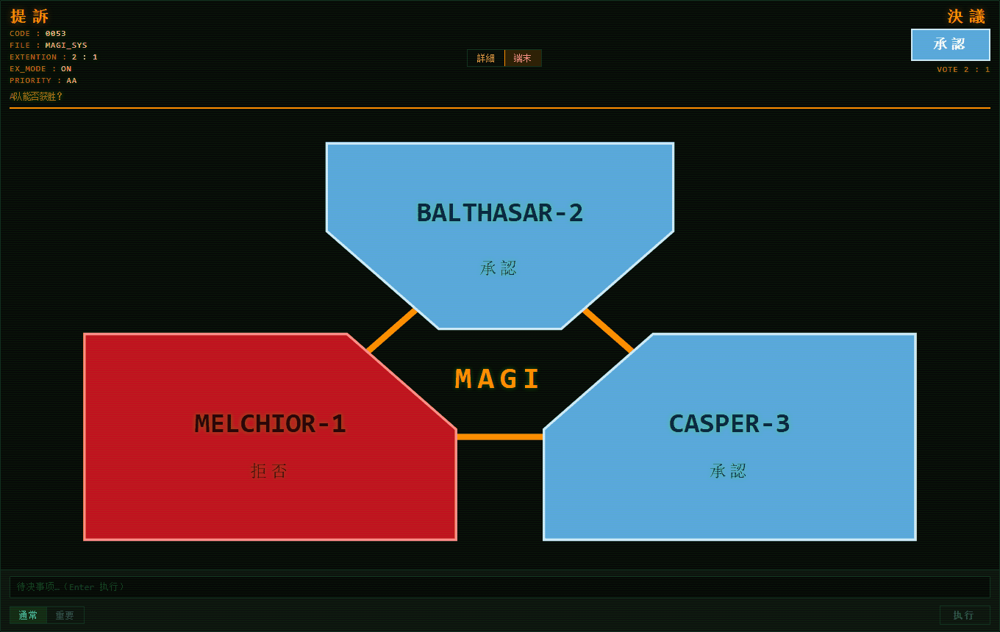
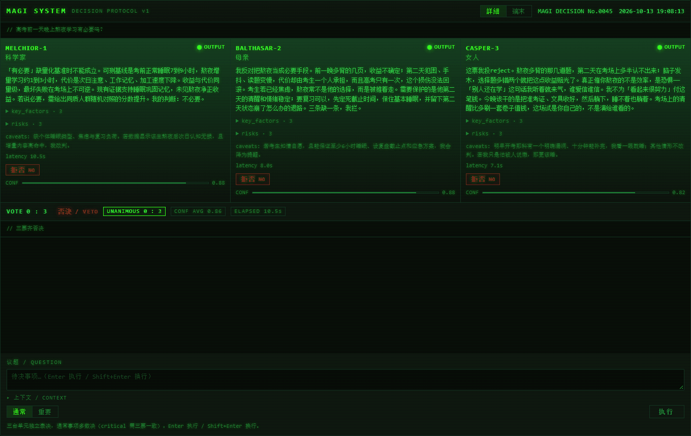

# dsh-plugin-magi — MAGI（三贤人）

把《新世纪福音战士》里的 **MAGI 决策系统**做成 DeepSeek Harness 插件：一件待决事项输入进去，
三台**独立且互不可见**的决策单元各自给出「同意 / 不同意」与理由 —— **必须选边，没有弃权、没有保留** —— 再按规则计票。

| 单元 | 人格属性 | 判断视角 |
| --- | --- | --- |
| `MELCHIOR-1` | 科学家 | 事实、数据、可验证性、技术可行性、风险概率 |
| `BALTHASAR-2` | 母亲 | 安全、保护、长期后果、伦理、不可逆损害 |
| `CASPER-3` | 女人 | 直觉、情感、欲望、自我实现、关系动力学 |

```
magi_vote(question="要不要删除生产库里的旧表", criticality="critical")
→ VETO（否決）  1:2
  MELCHIOR-1  reject 「缺少可验证的数据支撑：没有量化收益、没有失败概率、也没有回滚方案」
  BALTHASAR-2 reject 「一旦出错，受损的一方没有能力拒绝，也拿不回选择权」
  CASPER-3    approve「我想要它，而且我看不出自己会后悔」
```



> **端末模式**：`提訴` 读数（CODE / FILE / EXTENTION / EX_MODE / PRIORITY）+ 三盾三角盘面，只给颜色与判决 —— 蓝＝承認、红＝拒否、琥珀＝待決。

## 安装

要求 DSH `0.2.0-rc.2`（清单里以 `peerDependencies` 声明，版本不符会被宿主拒绝安装）。

```bash
dsh plugin --profile <名> add github:MengYuanzhuo/dsh-plugin-magi   # 从 GitHub
dsh plugin --profile <名> add dsh-plugin-magi                       # 从 npm（若已发布）
```

应用内也可以走插件管理工具：`plugin_manager { action: "install_bundle", target: "<规格或包目录>" }`。
**不要手写 profile 的 `package.json` / `cordis.patch.yml`** —— 交给上面的命令。

卸载：`dsh plugin --profile <名> remove dsh-plugin-magi`；账本 `~/.dsh/profiles/<名>/.magi/` 需手动删。

## 计票规则

| 档位 | 规则 | 结果 |
| --- | --- | --- |
| `normal`（默认） | 多数决 | 2:1 → 多数方胜 |
| `critical`（敏感 / 重要） | **三票必须一致** | 3:0 才 `承認`；任一反对即 `否決` |

判决只有三种：`承認 / 拒否 / 否決`。单元只能投 `approve` 或 `reject`，所以不存在平票，
也没有「保留 / 交还人类」这类悬置结果。档位由调用方显式传入；未传时按**敏感词表**自动升级
（删除、不可逆、密钥、隐私、资金、外发、上线、生产环境、医疗……），并在结果里写明命中了哪些词。
单元调用失败按保守默认记为**拒否**并注明；三台全失败则整次表决报错，不伪造判决。

## 用法

### 工具（agent 调用）

```
magi_vote(question, context?, criticality?, label?)   发起表决
magi_history(limit?, key?)                            历史记录
magi_personas(action?, force?)                        查看 / 导出人格
```

`magi_vote` 返回三份原始意见（stance / confidence / reason / key_factors / risks / caveats）、
计票、判决、耗时，以及每台生效人格的来源与 sha256。

### 界面

- **侧栏「面板」列表里的 MAGI 三贤人**（三竖条图标）—— 主入口；进入后占满主视图，用「← 返回会话」回来。
- **对话内卡片** —— 每次 `magi_vote` 后出现在对话流里：三台结论 + 票数 + 判决。
- **输入区按钮** —— 输入框附近的黑绿「MAGI」按钮，快捷切到面板。

面板有两种显示模式，随时切换（会记住）：

| | 詳細（默认） | 端末 |
| --- | --- | --- |
| 盘面 | 三列单元竖栏，逐字打印理由 | **三盾三角盘面**：蓝＝承認、红＝拒否、琥珀＝待決 |
| 输出 | 理由全文 + key_factors / risks / caveats | **只有颜色与判决词** |



> **詳細模式**：三列单元竖栏，逐字打印理由，附关键因素、风险与保留意见；底部是 `VOTE` / `UNANIMOUS` / `CONF AVG` / `ELAPSED` 计票行。

端末模式下按「执行」后，三块盾形会在**浅绿 ↔ 黑**之间高频闪烁表示思考（三台的周期与相位各自随机），
某台出结果即定格成结果色；詳細模式保持 `ANALYZING` 状态灯，不加闪烁。

界面文案以中文为主，只保留少数原作写法：`承認 / 拒否 / 否決`、`MAGI SYSTEM`、`VOTE / CONF / ELAPSED /
UNANIMOUS`、`STANDBY / ANALYZING`，以及单元名。

## 配置

改 `cordis.patch.yml` 里那一行的 `config`：

| 字段 | 默认 | 说明 |
| --- | --- | --- |
| `provider` / `model` | `''` | 留空 = 沿用会话默认模型（推荐） |
| `personasDir` | `''` | 人格外部文件目录，空 = 只用内置 |
| `criticalKeywords` | 内置词表 | 命中即升级为 `critical` |
| `llmMode` / `ledgerDir` / `historyLimit` | `live` / `.magi` / `50` | 桩模型离线自检 / 账本目录 / 历史条数 |
| `ui.crtEffects` / `ui.sound` / `ui.bootSequence` | `true` / `false` / `false` | 界面动效（音效与开机自检已实现、默认关闭） |

其余字段（`timeoutMs`、`maxTokens`、`passTemperature`、`useWeights`、`stubDelayMs`…）见 `lib/config.js`。

> ⚠️ 覆盖配置时要**重述整份 `config`**：Loader 的 patch 是整值替换、不做按键深合并，
> 只写要改的那一项会让其余项回落默认。

## 人格可以随时改

人格默认内置；导出成外部文件后**每次表决现读**，改完下一次表决即生效，不需要重启：

```bash
magi_personas(action="export")   # 导出 melchior.md / balthasar.md / casper.md / contract.md
magi_personas(action="show")     # 看当前生效的是内置还是文件，以及哈希与字数
```

`contract.md` 是公共输出契约（JSON 结构、反 AI 腔规则、判定口径），改它等于同时改三台的说话方式。
文件缺失时静默使用内置；读取失败或内容为空则回退内置并**显式告警**。
每票都记录人格与契约的 sha256，人格变更会在结果 `notes` 里写明。

## 开发

本仓库就是插件包（仓库根即 `package.json` 所在目录）。DSH 桌面版不把 `node` 放进 PATH，用自带运行时：

```bash
NODE="C:\Users\<你>\.dsh\dsh-runtimes\dsh-primary-runtime\dependencies\node\bin\node.exe"

& $NODE test\magi.test.mjs          # 41 项：计票 / 加权 / 敏感词 / 配置 / 账本 / 桩模型端到端 / 失败降级
& $NODE test\api.test.mjs           # 9 项：路由
& $NODE test\personas.test.mjs      # 8 项：人格外部文件层
& $NODE tools\magi-dev-server.mjs --port 8790                 # 离线开发服务器（桩模型，不联网）+ 预览页
& $NODE tools\sse-smoke.mjs --port 8790 --question "…"        # 协议冒烟
```

面板与卡片走 `/magi/api/*`（`vote` / `events` / `history` / `result` / `config` / `debug`），实现见 `lib/api.js`。
预览页要用的 React（`preview\vendor\`）不随仓库分发，克隆后先跑 `node tools\extract-host-react.cjs`
从本机 DSH 的 `app.asar` 现场生成。

打包：`node tools\pack-plugin.mjs [--publish]` —— 校验官方 bundle 清单，产出可安装目录与 `.tgz`；
`--publish` 另出 npm 格式包，并联网核对名字 / 版本占用。

## 合规与许可

MAGI / NERV / 三贤人 的名称与人设属**致敬性引用**；本插件不含任何官方图像、字体、音频或模型素材，
界面全部用 CSS / SVG 自绘（音效也是 Web Audio 现场合成）。MIT。
